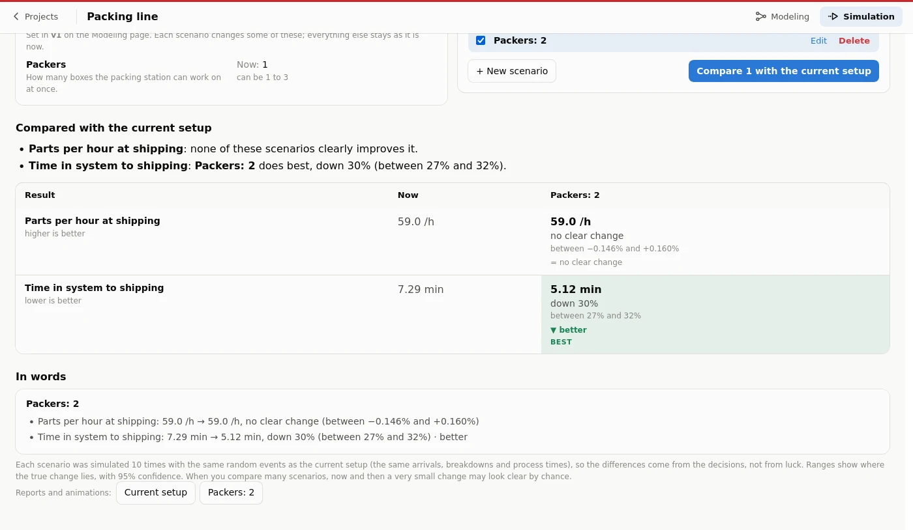

  

**Open-source discrete event simulation.**

Models are plain YAML files: you can diff them, review them, test them and run them headless.
A web app draws, runs and animates them, and lets managers compare scenarios in plain
language. Every result comes with a confidence interval, and the engine is checked against
queueing theory on every build.

It is one static binary or one small Docker image, with no database and no license server, so
it runs on a laptop, a CI job or a shared server for the whole team.

!!! warning "Early development"
    The model format is versioned (`simulancer/0.1`) and can still change.

## Features

- **Models as text.** One YAML file per model, with errors that point at the line. Scenarios list only what changes. Diff and review them like code.
- **Manufacturing, logistics and services.** Sources, servers with failures, accumulating conveyors, queues, paced lines, vehicles, shared resources, shifts, part types and attributes, batches, assembly and splitting, restocking.
- **Statistics done right.** Every result is a mean with a 95% confidence interval over replications. Scenarios are compared on common random numbers, and every run checks its warm-up.
- **Validated.** The engine is tested against exact results from queueing theory on every build.
- **A web app for two audiences.** Engineers draw and version models on the *Modeling* page. Managers build scenarios from the decisions the model offers on the *Simulation* page and read the answer in words: *"Lead time: 9.10 min → 7.24 min, down 20% (between 18% and 23%) · better"*.
- **Easy to run anywhere.** One static Linux binary (plus git) or a small Docker image. The reports are single HTML files that work offline.

  
  
  

## Where to go next

- [Why open source](why.md): what's wrong with commercial simulation tools, how SimuLancer answers each problem, and a comparison table.
- [Getting started](getting-started.md): download it, run an example, open the web app.
- [Tutorial](tutorial.md): build a model from scratch on the Modeling page and compare a scenario.
- [Model files](models.md): the YAML format, object by object.
- [Methods](methods/replications.md): replications, warm-up, comparisons and how the engine is validated.
- [HTTP API](api.md): everything the web app does, for scripts and integrations.
- [Deploying](deploy.md): run it for a team, behind your own proxy.
- [About](about.md): license, credits and contributing.

## Crates

| Crate | Description |
|---|---|
| `simulancer-engine` | The simulation core: standard units only, no file formats, no I/O |
| `simulancer-model` | Loads and validates the YAML model files and converts units for the engine |
| `simulancer` | The command line (`validate`, `run`, `compare`, `serve`), with the web app compiled in |
