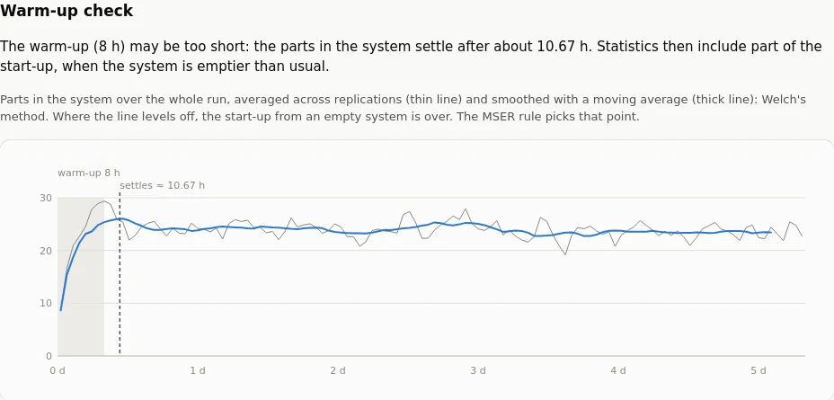

# Warm-up

Most models start empty: no parts on the conveyors, nobody in line, every machine idle. A real line in the middle of a week isn't like that. Statistics collected while the model fills up describe a system emptier than usual, so they bias the results: waits look too short and machines look too idle.

The fix is a **warm-up**: the model runs for a while before statistics start.

```yaml
experiment:
  replications: 30
  warmup: "8 h"          # statistics start after it
  run_length: "120 h"    # measured time, after the warm-up
```

The animation and the event log cover the whole run, warm-up included.

## The warm-up check

The question is how long the warm-up must be. Every run answers it: the report has a *Warm-up check* section, `summary.json` has `warmup_check`, and `simulancer run` warns when the warm-up looks too short.

{ .shot }

This is the conveyor line from the examples. The count of parts in the system climbs from zero to about 24 in the first hours, then moves around that level. The model's warm-up of 8 hours (shaded) ends a little before the count settles, at about 10.7 hours, so the check says the warm-up may be too short.

### How it works

- **What's measured:** the number of parts in the system, over the whole run, as a time average over equal intervals ("bins"). Every part that enters is counted (created, stocked, split off, assembled) until it leaves (exits, is lost, gives up or is consumed).
- **Welch's method for the plot:** the mean across replications in each bin (thin line), smoothed with a centered moving average (thick line). Averaging across replications removes most of the noise, and smoothing removes the rest.
- **MSER for the suggestion** (White, 1997): for every candidate cut, it takes what's left after the cut and measures its spread relative to its length. The cut with the smallest value is suggested. The search goes up to half the run.
- **When it never settles:** if the best cut is at the limit (half the run), the count may still be changing at the end. Either the run is too short, or the system never settles because something works above its capacity and the line keeps filling up. The report says so, and the results then describe the time simulated, not a steady state.

### Models with shifts

With shifts, the count follows the week: it rises during work hours and empties overnight or at the weekend. A cut in the middle of that cycle would mean nothing, so for models with schedules:

- bins are days, and the moving average spans a whole week;
- MSER cuts weekly means, so the suggestion is in whole weeks;
- with fewer than four full weeks of run, the check shows the plot but gives no verdict.

## Choosing the warm-up

1. Run the model with a generous warm-up and run length.
2. Read the check. Set the warm-up a bit above the suggestion.
3. Make the run length several times the warm-up. Short runs leave little steady state to measure.

## References

- Welch, P. D. (1983). The statistical analysis of simulation results. In S. S. Lavenberg (Ed.), *Computer Performance Modeling Handbook*. Academic Press.
- White, K. P. (1997). An effective truncation heuristic for bias reduction in simulation output. *Simulation*, 69(6), 323–334.
- Law, A. M. *Simulation Modeling and Analysis*. McGraw-Hill. (Welch's method is in the chapter on output analysis.)
