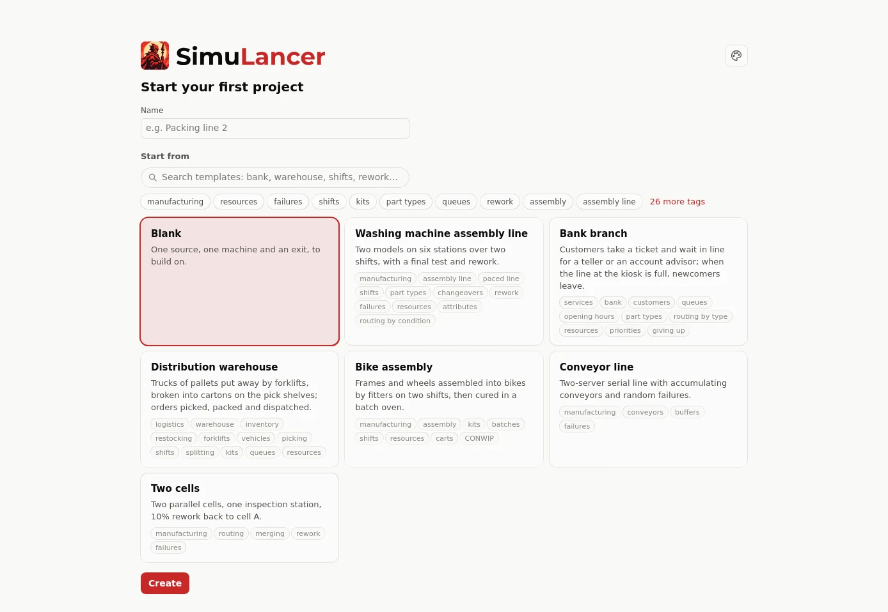
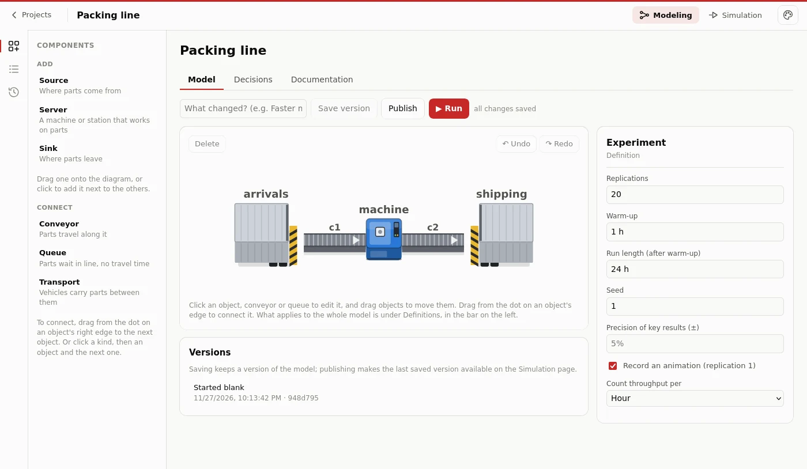
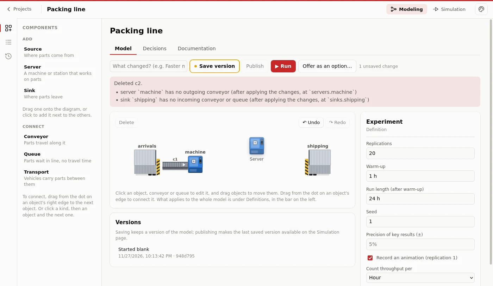
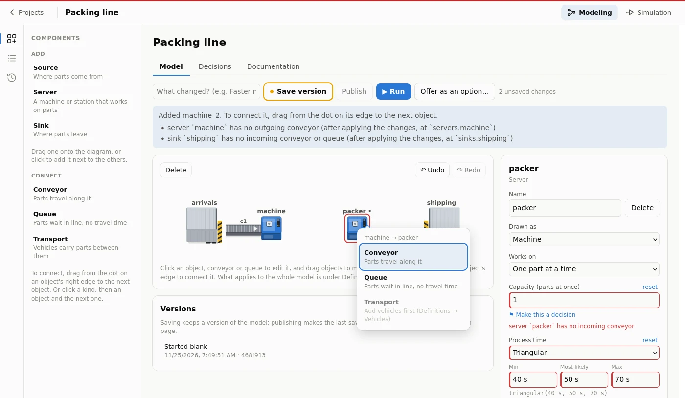
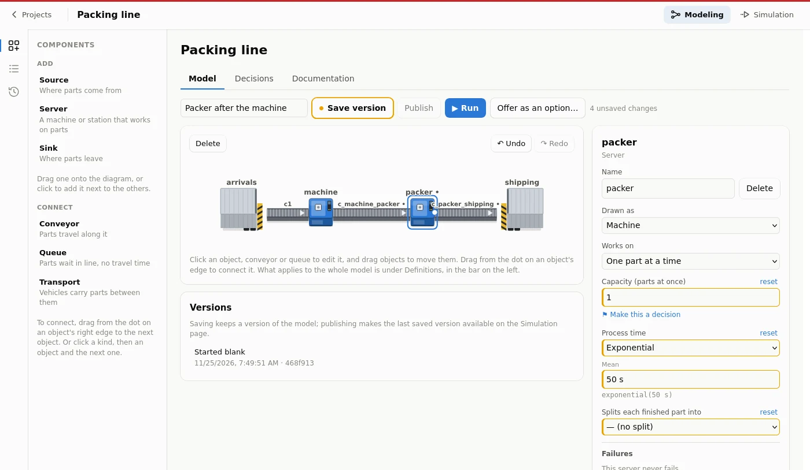
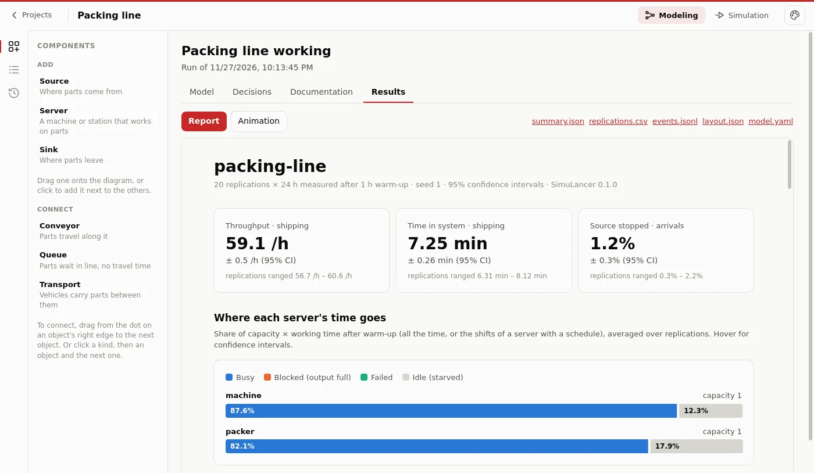
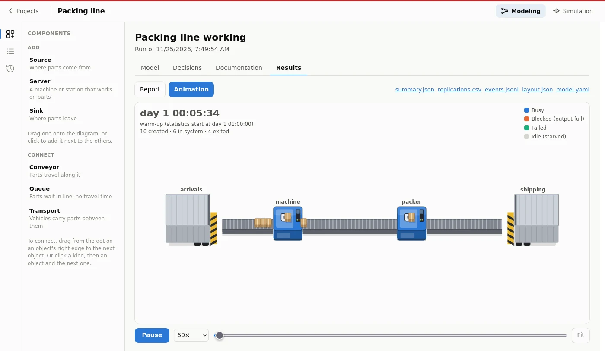
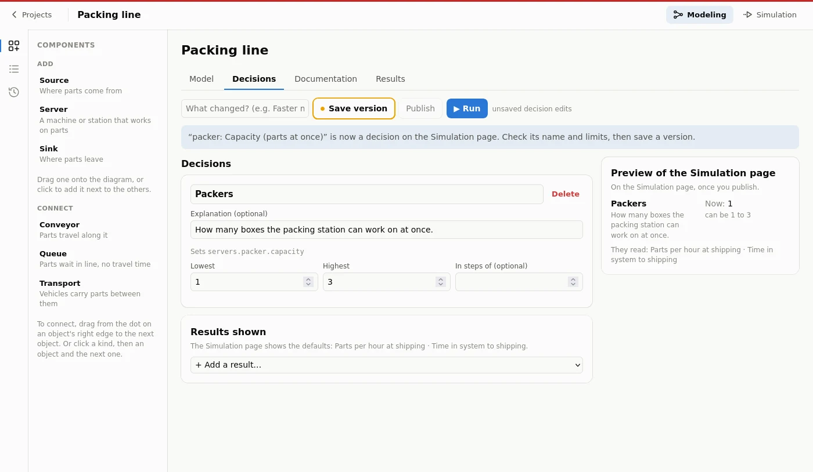
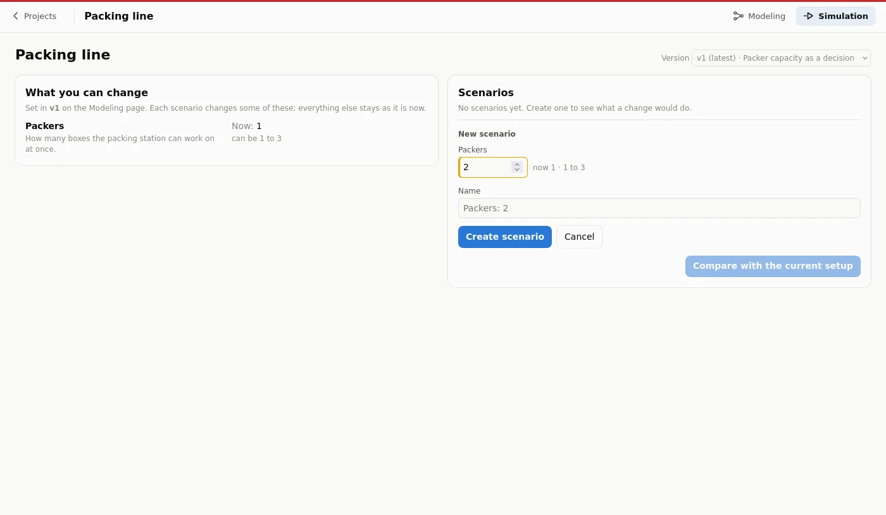
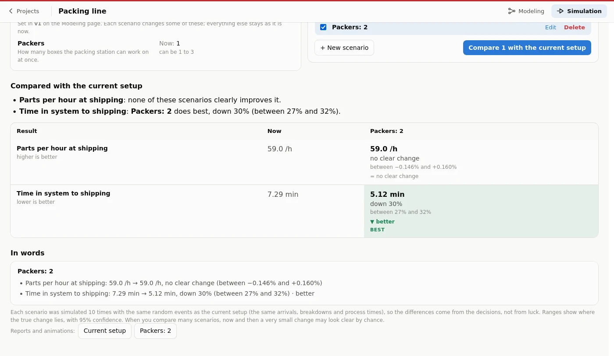

# Tutorial: a packing line

This tutorial builds a small model in the web app, from a blank project to a scenario a manager can compare. It takes about ten minutes. You'll:

1. start a blank project;
2. add a packing station after the machine;
3. save a version and run it;
4. offer the packer's capacity as a decision and publish;
5. compare two packers with one on the Simulation page.

Start the server (see [Getting started](getting-started.md)) and open <http://localhost:8080>.

## 1. Start a blank project

A new server has no projects, so the first page offers to start one. Type a name, **Packing line**, keep **Blank** selected and click **Create**. The templates are complete models from several industries, worth opening later.

{ .shot }

A blank project is a simple line: parts arrive about once a minute (`exponential(1 min)`), one machine works on them for 40 to 70 seconds, and they leave at *shipping*. Conveyors 4.6 m long connect them.

{ .shot }

The Modeling page has three parts:

- **the bar on the left:** *Components* (what you can add), *Definitions* (part types, resources, schedules, the experiment...) and *Runs*;
- **the diagram** in the middle, with *Versions* under it;
- **the panel** on the right, which edits whatever you click.

## 2. Add a packing station

Make room first: drag *shipping* to the right. Then click the conveyor between *machine* and *shipping* and **Delete** it.

Now drag **Server** from *Components* onto the gap. A preview follows the pointer, and the new server lands where you let go.

{ .shot }

The new server is selected, so the panel shows it. Rename it **packer**. The model has errors now (*machine* has no way out, and *packer* no way in), and they show next to the fields and at the top of the page.

To connect two objects, drag from the dot on the right edge of the first to the next one, then choose how parts get there: a **conveyor** (they travel along it), a **queue** (they wait in line, with no travel time) or a **transport** (vehicles carry them, once the model has vehicles).

{ .shot }

Connect *machine* to *packer* and *packer* to *shipping* with conveyors. Their lengths follow the drawing: drag an object and the conveyors stretch with it.

Finally, click *packer* and set its **Process time** to *Exponential* with a mean of **50 s**. Changed fields are marked until you save, and **reset** puts a field back.

{ .shot }

!!! tip "Undo"
    Every edit, moves included, can be undone and redone with the buttons above the diagram.

## 3. Save a version and run it

Write what changed in the box next to **Save version** ("Packer after the machine") and click it. Each version is a git commit in the project's own repository, listed under *Versions*. You never need to know git.

Click **▶ Run**. The run takes a second or two, then the *Results* tab opens with the report:

{ .shot }

Every number is a mean over the replications (20 here, set under *Definitions → Experiment*) with its 95% confidence interval: about 59 parts per hour, each spending 7.25 ± 0.26 minutes in the system. The machine is busy 88% of the time and the packer 82%. Further down are the warm-up check, conveyor fill and the full table. See [Results](results.md) for each section.

The **Animation** tab replays the first replication on the drawing:

{ .shot }

## 4. Offer a decision and publish

The packer is busy most of the time, so would a second one help? Instead of changing the model, let the people who decide try it.

Click *packer* and, under **Capacity**, click **⚑ Make this a decision**. The *Decisions* tab opens. Give the decision a name people understand (**Packers**), an explanation, and its limits (1 to 3). The preview on the right shows how the Simulation page will look.

{ .shot }

Save a version ("Packer capacity as a decision"), then click **Publish**. Only published versions reach the Simulation page, so you can keep working on the model without changing what managers see.

## 5. Compare scenarios

Click **Simulation** at the top right. This page has no diagram and no YAML: it lists what can be changed, with the current value.

Click **+ New scenario**, set **Packers** to 2 and click **Create scenario**. The name is filled in for you.

{ .shot }

Click **Compare 1 with the current setup**. Both run on the same random numbers (the same arrivals and the same process times), so the difference comes from the decision, not from luck:

{ .shot }

A second packer doesn't ship more boxes, because the line can only ship what arrives. But each box spends 31% less time in the system (between 28% and 34%). Whether that's worth another packer is the manager's call, and now it's an informed one.

## Next steps

- Open a template, such as the bank branch or the warehouse, to see shifts, resources, vehicles and part types at work.
- Read [Model files](models.md) for everything a model can say. The Modeling page writes the same YAML, and **model.yaml** next to each run's report is the exact file that ran.
- On the *Documentation* tab, write down what the model can't say for itself: assumptions, business rules, where the data comes from.
- Read about the [methods](methods/replications.md) behind the numbers.
